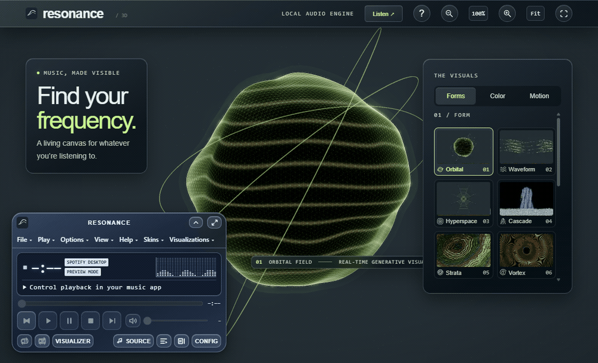
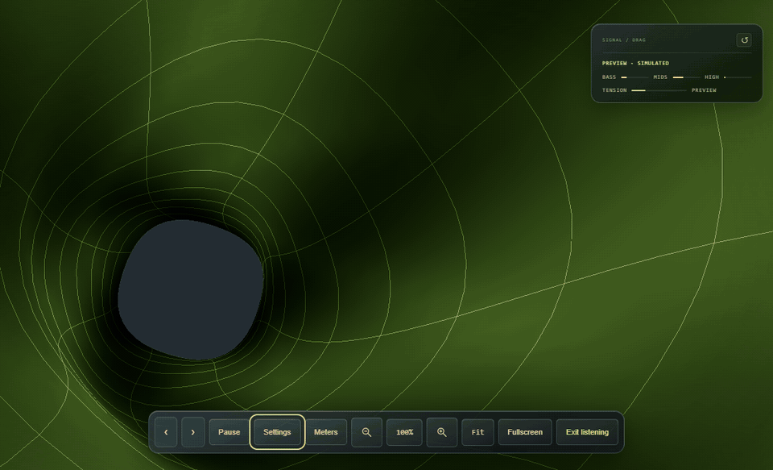

# Resonance


Resonance is a local music visualizer with 13 audio-reactive Forms and a Winamp-inspired playback deck. Visualize Spotify, Apple Music, or microphone input, or explore every Form in Preview mode. The Windows deck also plays local audio files.



The Windows demo uses a local audio file and the Glass Midnight skin. The Listening demo below uses Preview mode in the browser.

## Download Resonance 2.5.1

The v2.5.1 release bundles the five current platform packages and a source ZIP. The app packages include the menu fix and retain their 2.5.0 version numbers.

| Platform | Download |
| --- | --- |
|  Windows x64 | [Portable EXE](https://github.com/aapostoliadis/resonance/releases/download/v2.5.1/Resonance-Windows-x64-Menu-Fix.exe) |
|  macOS, Apple Silicon | [Apple Silicon ZIP](https://github.com/aapostoliadis/resonance/releases/download/v2.5.1/Resonance-macOS-Apple-Silicon-Menu-Fix.zip) |
|  macOS, Intel | [Intel ZIP](https://github.com/aapostoliadis/resonance/releases/download/v2.5.1/Resonance-macOS-Intel-Menu-Fix.zip) |
|  Android | [Signed APK](https://github.com/aapostoliadis/resonance/releases/download/v2.5.1/Resonance-Android-Menu-Fix.apk) |
|  iPhone | [Xcode project ZIP](https://github.com/aapostoliadis/resonance/releases/download/v2.5.1/Resonance-iPhone-Xcode-Menu-Fix.zip) |

The macOS builds require macOS 13 or later. The Android APK requires Android 8 or later, and the iPhone project targets iOS 16.4 or later.

On Windows, click **Visualizer** in the deck to open the fullscreen stage with **Settings** visible. On iPhone, build and sign the project in Xcode before installing.

[Source ZIP from main](https://github.com/aapostoliadis/resonance/releases/download/v2.5.1/Resonance-Source-main.zip) · [Release notes](https://github.com/aapostoliadis/resonance/releases/tag/v2.5.1) · [SHA-256 checksums](https://github.com/aapostoliadis/resonance/releases/download/v2.5.1/SHA256SUMS.txt) · [Installation and verification notes](docs/INSTALL.md)

## Run locally

Install Node.js, clone this repository, and run the included local server. The compiled graphics are included.

```sh
npm start
```

Open **http://127.0.0.1:4387** in desktop Edge or Chrome. On Windows, you can also double-click `Start.cmd`.

1. Choose a Form, then use **Listen** for a larger stage.
2. Start a track in your music app or browser.
3. In Resonance, open **Connect audio** and pick your service. Select **Share music audio**, then share the music tab with tab audio enabled. On Windows, you can also share your screen with system audio enabled for music playing in a desktop app, if your browser offers that option.
4. Use **Motion** to adjust camera movement and audio sensitivity. The camera can be turned off independently, and the visuals can be paused.

Audio is analyzed on your device. Resonance uses the shared audio track and discards the video frames.

## Forms and listening mode



| Form | Motion |
| --- | --- |
| Orbital | A wireframe sphere expands on bass kicks while bands and rings orbit around it. |
| Waveform | Four ribbons stretch across the stage with traveling highlights and camera bank. |
| Hyperspace | The camera rides a twisting tunnel, with extra speed on bass and kicks. |
| Cascade | Falling cyan filaments, a shifting crest, and turbulent foam respond at different depths. |
| Strata | Mineral ridges and fine fibers light up as accents travel through the layers. |
| Vortex | Spiral filaments revolve around a dark eye while beats light up sections of the spiral. |
| Pulse | Concentric rings and luminous beads carry radial accents around a teal iris. |
| Ember | A layered flame flickers as beats illuminate bands within it. |
| Flux | Pigment folds flow across the frame with granular detail. |
| Relic | Sculpted folds and cavities shift as light travels along the relief. |
| Swarm | A 3D particle volume curls and billows beneath a wider camera orbit. |
| Fractal | Nested hexagons and branching contours carry outward bass waves and traveling glints. |
| Horizon | Smoke and terrain animate independently beneath a slow camera pan. |

Choose built-in or named custom palettes, save listening presets, or compare the same eight seconds of visual input with music response on and off. Listening mode provides Form switching, zoom, Fit and Fill, and fullscreen. Graphics use Three.js when WebGL is available and switch to Canvas if needed.

## Playback and platform support

| Environment | Audio input | Playback controls |
| --- | --- | --- |
| Desktop browser | Tab audio, supported system audio, or microphone | Windows Spotify desktop via the local server. Apple Music web via the Edge bridge. |
| Windows desktop app | System audio or microphone | Spotify desktop through Windows media controls. |
| macOS desktop app | Microphone or system audio on supported macOS versions | Control playback in the music app. |
| Android and iPhone | Microphone for music playing through nearby speakers | Control playback in the music app. |

For Apple Music in Edge, load the unpacked extension from [edge-apple-bridge](edge-apple-bridge) in the same Edge profile as the Resonance and Apple Music tabs. Run Resonance on port **4387** or **4390**, reload both tabs, and leave one Apple Music tab open. Share that tab's audio from Resonance. The bridge reads the title, elapsed time, and duration and lets the deck seek when Apple Music exposes a seekable track. The integration was verified with an Apple Music preview.

## Develop

```sh
npm ci
npm test
npm run build
npm start
```

The portable test suite covers local playback and does not require a music service or audio capture. Packaged Windows and live-provider checks run separately.

### Build the Windows portable EXE

Use Node.js 24 on Windows x64. Run these commands from the repository root.

```sh
npm ci
npm ci --prefix packaging/windows
npm run package:win
npm run test:windows -- dist/windows/Resonance-Windows-x64.exe
```

The build writes `dist/windows/Resonance-Windows-x64.exe` and verifies the staged runtime files. The Windows smoke test launches that EXE and uses local test audio and a simulated Spotify session.

| Path | Role |
| --- | --- |
| `app.js`, `reactivity.js` | Web Audio input, onset and band analysis, camera and scene settings, presets, and Canvas rendering |
| `src/`, `graphics.bundle.js` | Three.js renderers, shader source, and the compiled browser bundle |
| `player.js`, `player.css` | Playback, spectrum display, skins, and the resizable deck |
| `server.cjs`, `spotify-media.ps1` | Loopback server and Windows Spotify media integration |
| `edge-apple-bridge/` | Local Apple Music metadata and seek integration for Edge |
| `desktop-main.cjs`, `desktop-preload.cjs`, `packaging/` | Electron and mobile app entry points |

Third-party notices and visual references are documented in [CREDITS.md](CREDITS.md).
